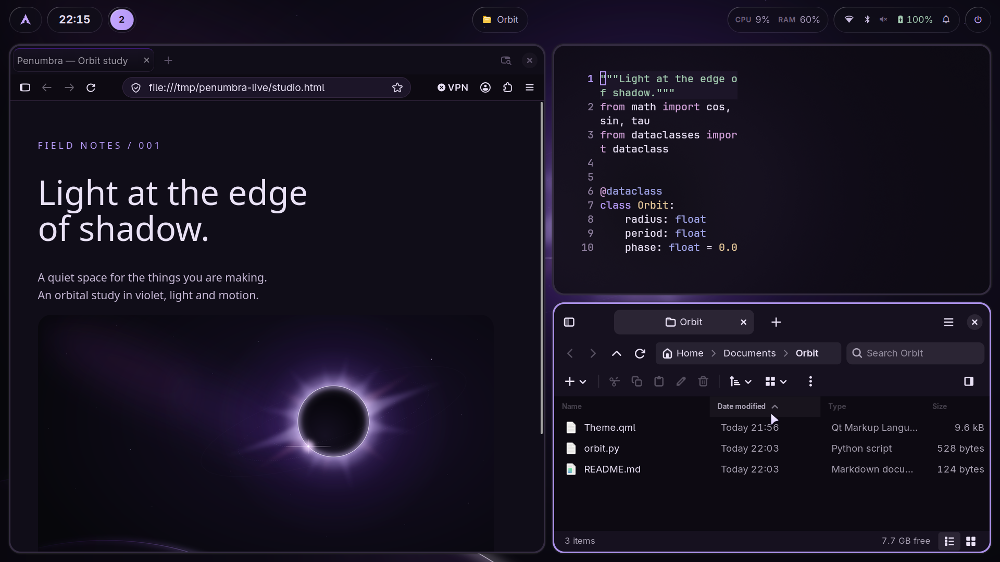

# PENUMBRA

Penumbra is a black-and-violet Wayland desktop for Arch Linux and its derivatives, including EndeavourOS and CachyOS. MangoWM tiles the windows. Save the apps and tags for a project, then type its workspace name in the launcher to resume it. A Quickshell bar puts workspaces, media, and system controls above a moonlit alpine lake. The same palette carries through the SDDM login screen, Kitty terminal, Fish prompt, and Neovim editor.



[Orbital desktop](previews/desktop.png) · [Aurora Borealis workspace](previews/aurora-workspace.png) · [Control Center](previews/control-center.png) · [Launcher](previews/launcher.png) · [Solar Corona](previews/solar-corona.png) · [Starlight](previews/starlight.png) · [Motion demo](previews/motion.webp)

## Install

### On an existing Arch system

Download the core `penumbra-desktop` package from the [releases page](https://github.com/TLia1/Panumbra/releases). Add `penumbra-apps` for app themes, `penumbra-editor` for Neovim, or `penumbra-boot` for boot artwork. Put the selected packages from the same release and its `SHA256SUMS` in one directory, then run these commands there as your desktop user.

```bash
sha256sum --check --ignore-missing SHA256SUMS
sudo pacman -U ./penumbra-*.pkg.tar.zst
penumbra-install
```

To install **from source**, open a terminal in the checkout and run `./install.sh` as your desktop user. To preview changes first, run `./install.sh --plan` (or `penumbra-install --plan` for packages).

The installer backs up the files it replaces and asks separately before changing boot themes. For upgrades, rollback, and removal, see the [release guide](docs/releases.md) and [uninstall instructions](docs/installation.md#uninstall).

### From a live Arch ISO

The interactive installer sets up Arch and Penumbra together. It erases the selected disk after confirmation. Follow the [fresh installation guide](docs/archiso.md).

## First login

Log out, choose **Mango** on the login screen, and sign in. **Super** is usually the key with the Windows logo.

| Shortcut | Action |
|---|---|
| Super+Space | Search apps, settings and saved workspaces |
| Super+Enter / Super+E | Open your terminal / file manager |
| Super+1–9 | Switch workspace using the physical number row |
| Super+A | Open the Control Center for Wi-Fi, Bluetooth, sound, and brightness |
| Super+, | Open Settings |
| Super+L / Super+M | Lock the screen / open the session menu |
| Super+F1 | Search all active keyboard shortcuts |

Moonwake, the default wallpaper, places the depth clock between mountain peaks. Music lights up fireflies along the wooded slopes. [See it in motion](previews/moonwake.webp)

To change the colours and wallpaper together, open **Settings → Look → Curated palettes**. **Apply signature layout** restores the floating capsules and numbered workspaces shown above while keeping your palette and text size.

## Guides

| Guide | What you’ll find |
|---|---|
| [Using the desktop](docs/desktop.md) | Shortcuts, clipboard history, displays, screenshots, recording, casting, and package management |
| [Appearance and app themes](docs/appearance.md) | Palettes, custom wallpapers, terminal colours, cursors, and themes for installed apps |
| [Installer settings and recovery](docs/installation.md) | Keyboard and scale options, personal config files, system changes, backups, and uninstall |
| [Boot themes](docs/boot-themes.md) | Optional GRUB, Limine, rEFInd, and Plymouth setup and recovery |
| [Neovim](docs/neovim.md) | Editor-only installation, shortcuts, plugins, and language servers |
| [Maintenance](docs/maintenance.md) | Shell logs, IPC commands, generated files, tests, and preview captures |
| [Extending Penumbra](EXTENDING.md) | Add a distribution, installer setting, or shell feature |

## Artwork and licensing

The shell, wallpapers, configurations, and helper scripts were created for Penumbra. The icon overlay includes unmodified violet folder icons from Papirus and inherits the rest from the installed theme. [Papirus source](https://github.com/PapirusDevelopmentTeam/papirus-icon-theme) · [GPL-3.0 license for the Papirus icons](licenses/Papirus-GPL-3.0.txt)
