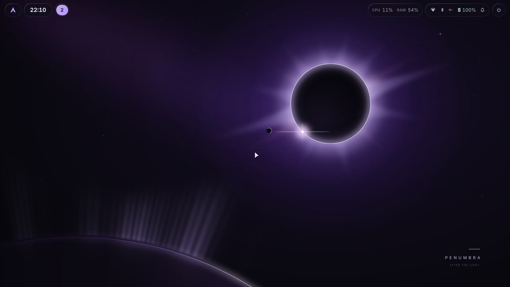
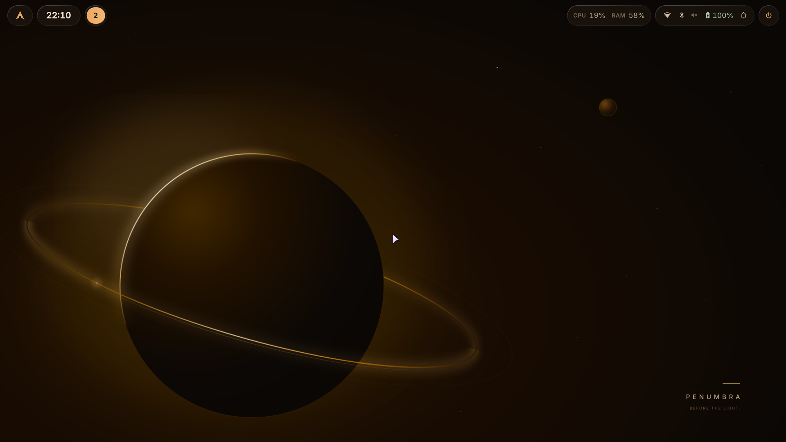
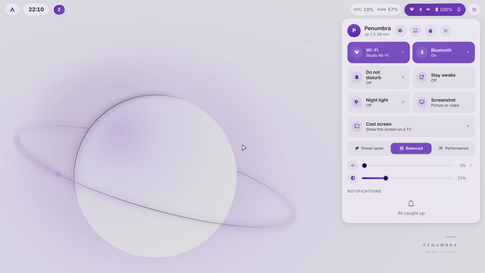
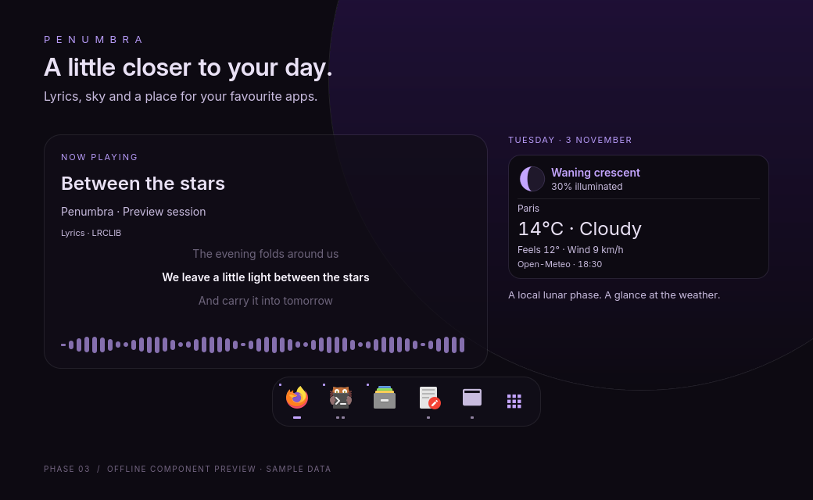
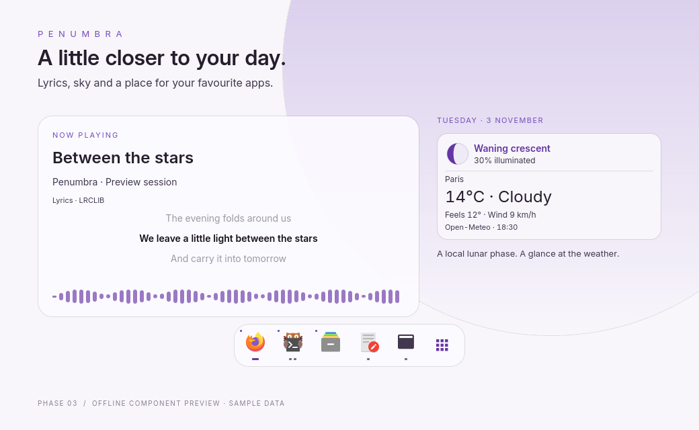
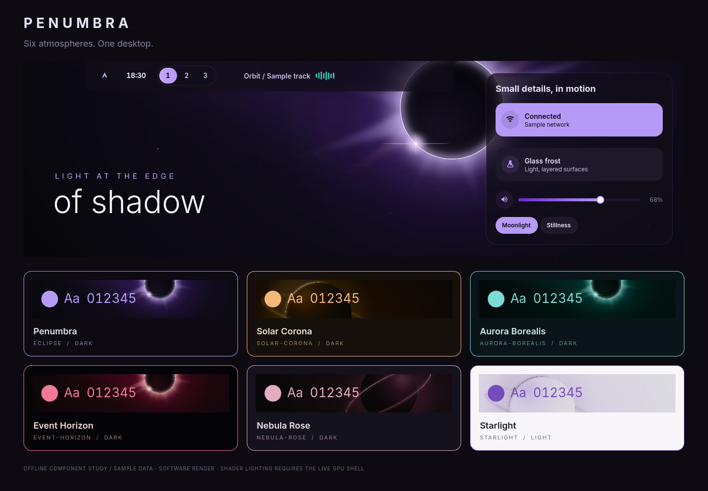

# PENUMBRA

An original black-and-violet desktop for Arch Linux and the distributions built on it (EndeavourOS, CachyOS…). Everything that differs between distributions lives in `distro/`, so others can be added; see [EXTENDING.md](EXTENDING.md), which also covers adding settings and shell features. Targets **Hyprland 0.56 with Lua configuration**, Quickshell 0.3, SDDM 0.21, Kitty 0.49 and Fish 4.



Floating capsules, numbered workspaces, comfortable 14 px body text, and an orbital scene
with room for your windows. **Settings → Look → Apply signature layout** restores this
composition without changing your palette, text scale, or reduced-motion preference.

| Solar Corona · amber dawn | Starlight · pearl and lavender |
|---|---|
|  |  |

[Working desktop](previews/workspace.png) · [Control Center](previews/control-center.png) ·
[Launcher](previews/launcher.png) · [Motion demonstration](previews/motion.webp)

These are live captures from an isolated Hyprland session using the current shell and shaders.
The workspace runs Firefox, Neovim and Lia Files with local sample content; the account and
network labels are demonstration values. See [visual validation](validation/visual-polish.md).

## Install

Copy this whole folder to the target machine, open a terminal in it, and run:

```bash
chmod +x install.sh
./install.sh
```

Run as your regular desktop user. The installer reads `/etc/os-release` to pick the distribution's folder in `distro/` (`--distro NAME` overrides it). Sudo prompts normally; no password is stored in the bundle. The installer uses the current pacman databases, official Arch packages, timestamped backups, and user-scoped configuration; pacman asks about conflicts and replacements as usual. It does not install anything from the AUR. On a substantially older Arch installation, perform a normal full system upgrade yourself first. Never use `pacman -Sy` alone. This installer does not update repositories. Optional GRUB, Limine and Plymouth theming asks separately before changing boot configuration; see Boot themes below.

### Your settings

Before changing anything, the installer shows the settings below and offers to change them. On the first run it detects the keyboard layout this machine already uses (`localectl status`, falling back to the console keymap, then `us`). Your answers are saved in `~/.config/penumbra/settings.conf` and reused by later runs; edit that file and run `./install.sh --user-only` to change them.

| Setting | Option | Default |
|---|---|---|
| Keyboard layout | `--layout fr` (several: `--layout us,fr`) | detected, else `us` |
| Layout variant | `--variant intl` | detected, else none |
| Keyboard options | `--kb-options caps:escape` | detected, else none |
| Display scale | `--scale 1.25` | `auto` |
| Num Lock at login | `--numlock off` | `on` |
| Login shell | `--shell keep` | `fish` |

Command-line options win over the saved file. `-y` uses the saved or detected settings without asking; `./install.sh --help` lists every option. The login screen gets the same keyboard layout as the desktop (through `localectl`, leaving the text console keymap alone).

In a virtual machine (`systemd-detect-virt --vm`), the installer also turns on software cursors in Hyprland and renders the login screen in software at scale 1 (`/etc/sddm.conf.d/91-penumbra-vm.conf`), since virtual GPUs often draw hardware cursors and accelerated QML wrongly. On real hardware both use the GPU, and the login screen follows the screen's scale.

Log out through **Super+M → Log out → Confirm**, then sign in again when convenient. The running desktop has already been configured; a fresh login applies the environment to every application and displays the new greeter. Existing applications may need reopening to pick up fonts, colors, and icons. Applications that enforce their own theme still use their own appearance setting.

The keyring unlocks with the password you sign in with, so it stays locked (and asks for its password the first time an app needs it) after an automatic login, or after you change your password some way other than `passwd`.

### Your own settings

`./install.sh` replaces Penumbra's configuration files on every run (keeping the old ones in a backup), so put your own changes in these files, which it creates once and never replaces:

| App | File | Read |
|---|---|---|
| Hyprland | `~/.config/hypr/user.lua` | after `hyprland.lua`, so it can change or add anything |
| Kitty | `~/.config/kitty/user.conf` | after `kitty.conf` |
| Neovim | `~/.config/nvim/lua/user.lua` | at the end of `init.lua` |
| Fish | any file in `~/.config/fish/conf.d/` | before `config.fish` (Penumbra only owns `penumbra-colors.fish` there) |

### Uninstall

```bash
./install.sh --uninstall
```

This undoes every install run, newest first, from the backups the runs left: files Penumbra added are removed and files it replaced come back, in your account and in the system (login screen, cursors). It also restores your previous login shell, login-screen keyboard layout, GSettings and Dunst. What is there just before uninstalling is kept in an `uninstall-TIMESTAMP` backup, in case you changed something since. Installed packages stay installed, SDDM stays enabled unless you switch to another display manager, and boot themes have their own undo (see Boot themes). `--uninstall --user-only` only touches your account.

## Included

| Component | Design / behavior |
|---|---|
| Hyprland | Lua, slowly rotating violet gradient borders, violet glow on the focused window, rounded or sharp windows, frosted-glass blur behind every shell surface and the launcher, soft window/workspace animations, a scratchpad, tabbed groups and three-finger workspace swipes; picture-in-picture video floats and follows you to every workspace, open/save dialogs float, and fullscreen windows keep the screen awake |
| Penumbra shell | Quickshell (QML) bar of floating capsules, control center, notification popups and history, volume/brightness OSD, calendar, session overlay, app launcher, clipboard history, emoji and symbol picker, lock screen, polkit password dialog and screenshot overlay; see "Penumbra shell" below |
| Rofi | Fallback launcher, clipboard history and session menu when the shell is not running |
| Kitty + Fish | Violet ANSI palette, animated cursor trail, Starship prompt, custom Arch logo and grouped Fastfetch greeting |
| Qt | Penumbra KDE and Qt palettes, Breeze widgets, Papirus violet folder overlay |
| GTK | Breeze Dark for GTK 3, Penumbra colours for GTK 3, GTK 4 and libadwaita apps (and the GTK save dialog), close button only |
| GRUB | Optional orbital wallpaper, violet menu selection, keyboard hints and countdown |
| Limine | Optional ringed-planet wallpaper (never stretched), spaced PENUMBRA branding, lavender selection, violet key hints and countdown, Kitty's palette in the editor |
| Plymouth | Optional splash: the wallpaper's planet with a moonlet riding its ring and a breathing glow, PENUMBRA wordmark, frosted password card with keyboard layout and Caps Lock indicators, update progress |
| SDDM | Original QML greeter laid out like the lock screen: the clock high in the centre, your initial, an editable username and a pill password field over the wordmark-free orbital wallpaper; keyboard layout switch, Caps Lock warning, session selector, suspend and restart/shutdown confirmation in the footer; scales with the screen |
| Lock screen | The shell's own: the current wallpaper without its wordmark (dawn and eclipse keep moving), clock, password field with keyboard layout and Caps Lock indicators, and media controls; dims after nine and a half idle minutes, locks at ten, turns the screens off at eleven and, on battery, suspends at thirty; it also locks before suspend. Hyprlock takes over when the shell is not running |
| Wallpaper | Three original SVG scenes, night, dawn and eclipse, plus pre-rendered PNGs and wordmark-free variants for the lock screen and greeter (`tools/build-wallpapers.py`); awww switches them with a transition that grows out of the planet. The shell animates dawn (twinkling stars, a breathing glow and rim light, a moonlet riding the ring, the odd shooting star) and eclipse (a drifting nebula, glinting stars, a swaying corona and diamond-ring flare, two backlit moons that pass in front of and behind the eclipse, an aurora on the near world's horizon, a blinking satellite, shooting stars); both pause under fullscreen windows. Your own images, GIFs and videos work too; see "Your own wallpapers" |
| Neovim | Penumbra colour scheme with Treesitter highlighting, file tree, tabs, fuzzy search, Git markers; see "Neovim coding workspace" |
| Passwords | gnome-keyring keeps the passwords apps save (browsers, editors, Git credential helpers, Flatpak apps through the portal) and unlocks with your password when you sign in through SDDM; Seahorse ("Passwords and Keys") manages them |
| Other apps | Penumbra colours for btop, bat, delta, fzf, lazygit, yazi, ls/eza, zathura, mpv (and uosc), VS Code / VSCodium, Vesktop and Firefox's toolbars, added only for the apps you have installed; see "Colours for other apps" |
| Tools | Screen recording (wf-recorder), casting the screen to a TV (Chromecast, Google TV and DLNA TVs), clipboard history (cliphist), color picker (hyprpicker), screenshot annotation (Satty), night light (hyprsunset), audio visualizer (cava) |

### Palette

Every colour is defined once, in [`palette/palette.toml`](palette/palette.toml): near-black `#0d0a12`, surface `#100d18`, violet `#b69af7`, text `#e9e1f5`, muted `#8f809f`, plus the signal and terminal colours. `python tools/build-palette.py` renders the templates in `palette/templates/` into the colour files each app reads: Kitty's `penumbra-colors.conf`, the GTK 3/4 stylesheets, the Qt6ct and KDE colour schemes, rofi's `colors.rasi`, Hyprland's `colors.lua` and `hyprlock-colors.conf`, Fish's `conf.d/penumbra-colors.fish`, Starship, Satty, Fastfetch, Neovim's `lua/penumbra/palette.lua`, the shell's `palette.js` and the greeter's. Change a colour there, run the script, then `./install.sh --user-only` (or `./install.sh` for the greeter). Generated files say so in their first line; `tests/test_generated.py` checks they are current.

### Colours for other apps

Lia Files can be installed separately from its [Arch PKGBUILD or Flatpak](https://github.com/TLia1/Lia-s-file-linux#install). Penumbra doesn't install it yet. Once it is installed, the installer makes it the file manager (Super+E, and the default app for folders), replacing a saved Dolphin choice (another choice is kept), and its native build becomes the **Open**, **Select Folder** and **Save** dialog of apps that use the file chooser portal, such as choosing where a download goes (`config/xdg-desktop-portal/portals.conf` prefers `lia`, then `gtk`). GTK apps (`GTK_USE_PORTAL=1`) and Firefox (a `user.js` preference) are set to use the portal; Chromium-based and Electron apps already do. Without Lia Files the portal uses GTK's dialogs. Dolphin is no longer installed; it is a legacy package the installer offers to remove, with the Qt 5 tools nothing uses any more (`qt5ct`, `qt5-wayland`, `qt5-quickcontrols2`). Run `./install.sh --user-only` after installing Lia Files to add its theme. This needs the Lia Files build with user stylesheet support. The native CSS goes in `~/.config/lia-files/`; Flatpak also gets a copy in `~/.var/app/io.github.lia.Files/config/lia-files/`. Both reload while the app is open. `penumbra-corners` controls its radii, while file surfaces stay almost opaque for readability. The installer selects the Penumbra preview schemes when the current scheme is Adwaita, and sets the desktop monospace font to JetBrainsMono Nerd Font 10. GtkSourceView schemes are shared under `~/.local/share/gtksourceview-5/styles/` and copied to the sandbox for Flatpak.

Apps Penumbra doesn't install get their colours from `apps/NAME/`, also rendered from the palette. The installer uses a folder only when the app's command is there, so the package list stays the same; installing the app later and running `./install.sh --user-only` again picks it up. Each app's own settings file is only added to (and kept in the backup like everything else); if it already chooses a theme of its own, that choice stays.

| App | What the installer does |
|---|---|
| Lia Files | watched `~/.config/lia-files/penumbra.css`, desktop corner style, glass surfaces and Penumbra text previews; native and Flatpak installs |
| btop | `~/.config/btop/themes/penumbra.theme`, chosen as `color_theme` in `btop.conf` |
| cava | `~/.config/cava/themes/penumbra`, a four-stop accent gradient chosen unless its config already names a theme; preserves audio/output settings and the terminal background, and reloads colours with `penumbra-theme` |
| bat | `~/.config/bat/themes/Penumbra.tmTheme`, `--theme="Penumbra"` in bat's config unless it names a theme, then `bat cache --build` |
| delta | `~/.config/git/penumbra-delta.gitconfig`, included from your Git configuration, with `penumbra` added to `delta.features` (syntax colours from bat's theme when bat is installed) |
| fzf, ls, eza | `FZF_DEFAULT_OPTS`, `LS_COLORS` and `EZA_COLORS` in Fish's colours file, unless you set them yourself |
| lazygit | `~/.config/lazygit/penumbra.yml`, which Fish adds to `LG_CONFIG_FILE` after your own `config.yml` |
| yazi | the `penumbra` flavor in `~/.config/yazi/flavors/`, chosen in `theme.toml` unless it has a `[flavor]` section |
| zathura | `~/.config/zathura/penumbra-colors`, included from `zathurarc` (Ctrl+R recolours pages in the palette) |
| mpv | `~/.config/mpv/penumbra.conf` (OSD, on-screen controller, uosc), included at the top of `mpv.conf` |
| VS Code, Code - OSS, VSCodium | a Penumbra theme extension installed with `--install-extension`; choose it in Preferences: Color Theme |
| Vesktop | `~/.config/vesktop/themes/penumbra.theme.css`, turned on alongside transparent windows in its settings; restart Vesktop after installing |
| Firefox | `chrome/penumbra.css` in every profile, imported from `userChrome.css`, with the `user.js` preference that lets Firefox read it (restart Firefox); toolbars, tabs and menus only, pages keep their colours. `user.js` also makes its Open and Save dialogs the portal's (Lia Files) |

`./install.sh --uninstall` puts those files back as they were and removes the editor extension. The animated wallpapers, boot artwork and cursors keep their own colours in their build tools.

Fonts: Inter, with Inter Display for large text (the lock and greeter clocks, panel headlines), and JetBrainsMono Nerd Font for the terminal, code and icons.

## Controls

| Shortcut | Action |
|---|---|
| Super+Enter / Super+Q | Kitty with Fish |
| Super+Space / Super+R | App launcher (`>` runs a command, `?` searches the web, `/` finds files; sums, units and currencies are worked out) |
| Alt+Tab | Jump to an open window (the launcher's Windows mode) |
| Super+E | Chosen file manager (Lia Files, or Dolphin if only that is installed) |
| Super+B | Your default web browser (`xdg-settings set default-web-browser NAME.desktop` changes it) |
| Super+C | Close focused window |
| Super+V | Toggle floating |
| Super+F | Fullscreen |
| Super+arrow | Focus adjacent window |
| Super+Shift+arrow | Move the window in that direction |
| Super+Ctrl+arrow | Resize the window (repeats while held) |
| Super+physical number-row key | Workspace 1–10, on any keyboard layout (AZERTY included) |
| Super+Shift+physical number-row key | Move window to workspace |
| Super+Alt+physical number-row key | Send window to workspace without following it |
| Super+S / Super+Shift+S | Show or hide the scratchpad / send the window there |
| Super+G | Group windows into tabs (Super+Tab and Super+Shift+Tab step through them) |
| Super+P | Pin a floating window to every workspace |
| Three-finger swipe | Previous / next workspace (touchpad) |
| Super+\` (the key left of 1) / four-finger swipe up | Overview of every workspace |
| Super+left/right mouse drag | Move / resize |
| Super+J | Toggle split direction |
| Super+M | Session overlay |
| Super+A | Control center |
| Super+, | Settings (search, look, wallpaper, displays, keyboard, idle, notifications, default apps, accessibility…) |
| Super+L | Lock |
| Super+N | Clear notifications |
| Super+Shift+V | Clipboard history |
| Super+; | Emoji and symbols (Tab switches between them) |
| Super+Shift+C | Pick a color on screen; copies its hex value |
| Super+W | Next wallpaper (Penumbra's, then yours) |
| Super+Shift+W | Wallpaper picker |
| Super+Shift+R | Restart the shell |
| Print | Screenshot a region, window or the whole screen; save to `~/Pictures/Screenshots` and copy it |
| Shift+Print | The same, then annotate it in Satty |
| Ctrl+Print | Record a region, window or the whole screen to `~/Videos/Screencasts`; press again to stop (right-click the bar's red capsule to pause) |
| Audio / media / brightness keys | Volume and brightness (repeat while held), mute, playback, where hardware supports it |

Bar: click the Arch logo for the launcher (right-click for the clipboard) and the clock for a calendar: the month (with week numbers if you click Wk), a dot under each day with events, and the chosen day's events. They come from `.ics` files in `~/.local/share/penumbra/calendars` (put exported calendars there), `~/.calendars` or `~/.local/share/vdirsyncer`, where vdirsyncer keeps CalDAV calendars (Nextcloud, Fastmail, iCloud, Google) in step; repeating events follow the common rules (`bin/penumbra-calendar`). While something plays, a capsule shows it with a small spectrum: click for the control center, middle-click to pause, scroll to skip. CPU/RAM open the system monitor (right-click for btop): live graphs of the processor (with a bar per thread, temperature and clock), memory, GPU, disk activity and network, how full each drive is, and on a second page the busiest apps, which you can end. On a hybrid laptop click the GPU card to switch GPUs; a discrete GPU that is asleep stays asleep rather than being woken to be measured. With several keyboard layouts, a capsule shows the current one; click it to switch. Click the network/Bluetooth/audio/battery capsule (or press Super+A) for the control center; its tooltip also lists the batteries of headsets, mice, keyboards and controllers; right-click it for pavucontrol, scroll it for volume. Tray icons are tinted violet until hovered; right-click for their menu. Hover any capsule for details. Push the pointer into the top-right corner for the control center. Destructive session actions require a second press to confirm.

## Files and destinations

- `config/` → `~/.config/` (all authored user configuration files, including the shell's systemd unit in `config/systemd/user/`).
- `distro/NAME/` → what differs on one distribution: `distro.sh` (packages and the package manager, the bar's logo glyph, fish's `update`), and `config/`, `bin/`, `share/` and `system/` folders installed over the common ones (the Fastfetch logo, the bar's update checks in `share/penumbra/updates.py`). See [EXTENDING.md](EXTENDING.md).
- `bin/` → `~/.local/bin/` (session, power and graceful exit, idle, screenshot, screen recording, casting, clipboard, calendar, color picker, OSD, update, GPU reading, wallpaper and shell IPC scripts).
- `config/quickshell/penumbra/` → the Penumbra shell (QML), run by `penumbra-shell.service`.
- `share/` → `~/.local/share/` (KDE color scheme and violet icon overlay).
- `assets/wallpaper*.png` (night, dawn and eclipse, each with a wordmark-free variant) → `~/.local/share/penumbra/`; `lock.png` there links to the clean variant of the current scene. After editing a wallpaper SVG, run `tools/build-wallpapers.py` to re-render them and the SDDM copy; it also splits the dawn and eclipse scenes into the layers under `config/quickshell/penumbra/dawn/` and `eclipse/` that the animated wallpapers move, and compiles the aurora shader (needs `qt6-shadertools`).
- `system/` mirrors absolute system paths: SDDM configuration and complete theme, and the cursor theme.
- `palette/` holds the palette and the templates of the generated colour files (see Palette).
- `apps/` holds colours for apps Penumbra doesn't install, used only when the app is (see "Colours for other apps").
- `share/kio/servicemenus/penumbra-wallpaper.desktop` and `share/lia-files/actions/penumbra-wallpaper.desktop` → Dolphin and Lia Files right-click **Set as Wallpaper** for images, GIFs and videos.
- `CONFIGURATION.md` contains the installer, palette, tools, scripts, every authored configuration and the wallpaper SVGs in one Markdown document. It is generated by `python tools/build-configuration.py`; run that after changing a file.
- `previews/` contains screenshots: `greeter.png` is current; `desktop.png` and `terminal.png` are of an earlier version, from before the theme was renamed, and still show the former name, Nocturne.
- `validation/` contains package versions and validation logs from the original build.

`@@PLACEHOLDERS@@` in configuration files (your home folder in the two Qt configurations; keyboard, Num Lock, scale and the cursor mode in `config/hypr/hyprland.lua`) are filled in by the installer as it copies them. All other paths are portable home-relative paths or fixed standard system paths. The default shell changes through `usermod`; the installer does not copy account/password databases.

## What the installer changes

1. Installs the packages listed explicitly in `distro/NAME/distro.sh`, with the distribution's package manager.
2. Backs up existing managed system files under `/var/lib/penumbra/backups/TIMESTAMP` and deploys SDDM and the cursors; in a virtual machine, adds the software-rendering greeter setting.
3. Sets the target user's login shell to fish (unless `--shell keep`) and the login screen's keyboard layout to yours. When fprintd is installed, asks whether administrator prompts should accept a fingerprint (default no).
4. Enables NetworkManager and Bluetooth, and enables SDDM without restarting it.
5. Backs up managed user files under `~/.local/state/penumbra/backups/TIMESTAMP` and copies this configuration. Files Penumbra no longer ships are removed from the folders it owns outright (`~/.config/quickshell/penumbra`, `~/.config/nvim/lua/penumbra`, `~/.local/bin/penumbra-*`), so a renamed shell component never lingers; they are in the backup too. Creates the starter files for your own settings if they are missing.
6. Applies GTK dark preference, font, cursor, icon and title-bar button settings through GSettings. Sets up gnome-keyring: makes sure SDDM's PAM file unlocks it at sign-in (Arch's already does; the installer adds the two optional lines if they are missing), routes the Secret portal to it, and tells KWallet (which comes with KDE apps) not to claim the same Secret Service name. Makes the chosen file manager the default app for folders once it is installed, and restarts the desktop portal when its file chooser preference changed.
7. Masks Dunst if installed, avoiding competing notification daemons.
8. Retires the previous Waybar/Mako/swaybg setup: asks whether to remove those packages, Dolphin and the unused Qt 5 tools (`PENUMBRA_REMOVE_LEGACY=1` or `0` answers in advance; removed versions are listed in the system backup), stops Waybar, Mako and swaybg, and moves `~/.config/waybar` and `~/.config/mako` into the user backup.
9. Enables PipeWire sockets and WirePlumber; reloads Hyprland and restarts the desktop components.

## Backups and rollback

Every installer run creates a new pair of backups, `~/.local/state/penumbra/backups/TIMESTAMP` and `/var/lib/penumbra/backups/TIMESTAMP`. `new-files.txt` records paths that did not exist before that run, `previous-shell.txt` the login shell, and the `gsettings-*.txt` files the GSettings values from before it. `./install.sh --uninstall` undoes all runs (see Uninstall). To undo only the latest run by hand, copy its saved files back to their original locations and remove the files listed in its `new-files.txt` after reviewing that list. Do not restart SDDM from a session with unsaved work: that ends the session.

## Maintenance

`ROADMAP.md` lists what could come next.

```bash
# Validate Hyprland and restart the shell
hyprctl configerrors
~/.local/bin/penumbra-session restart

# Reapply just the user files, without sudo or package installation
./install.sh --user-only

# After changing a colour in palette/palette.toml
python tools/build-palette.py
./install.sh --user-only

# Regenerate the wallpaper PNGs, the SDDM copy and the animated layers after editing an SVG
python tools/build-wallpapers.py
./install.sh

# Recompile the shell's shaders after editing one (needs qt6-shadertools)
python tools/build-shaders.py

# Regenerate CONFIGURATION.md, and run the tests (the shell's logic too, with Node.js)
python tools/build-configuration.py
python -m unittest discover -s tests -v

# Inspect logs
journalctl --user -u penumbra-shell -b
quickshell -c penumbra ipc show   # list the shell's IPC commands

# Preview SDDM without logging out; close preview when finished
sddm-greeter-qt6 --test-mode --theme /usr/share/sddm/themes/penumbra
```

Kitty uses its native cursor trail, avoiding expensive always-running custom shaders. Keyboard layout and display scale are installer settings (see Your settings). Penumbra keeps each monitor's preferred mode; choose another resolution, refresh rate, scale, rotation or arrangement in Settings → Displays, which writes `~/.config/penumbra/monitors.lua`.

## Penumbra shell

The bar, notifications, volume/brightness popup, control center, calendar, session overlay, launcher, lock screen, polkit agent and screenshot overlay are one Quickshell configuration in `config/quickshell/penumbra/`, replacing Waybar, Mako, Rofi, Hyprlock and the KDE polkit agent (Rofi and Hyprlock stay as fallbacks). Every surface is a translucent layer Hyprland blurs (namespaces `penumbra-*`).

It runs as the systemd user service `penumbra-shell.service`, which `penumbra-session` starts when Hyprland starts. If the shell crashes, systemd starts it again within a second; if the screen was locked, it locks again straight away (Hyprland keeps the session locked in between). Apps started from the shell run in their own systemd scopes, so restarting the shell (Super+Shift+R) never closes them.

- **Desktop depth and frame** (Settings → Look): optional clock and date behind the foreground planet in Dawn and Eclipse, plus an audio aura using the existing Cava stream: a radial spectrum in Dawn, and audio-driven curtains replacing the ambient drift in Eclipse’s foreground horizon aurora during playback. The curtains rise, brighten and fold with the frequency bands, settling to a faint rim during silence; the ambient aurora returns when the audio aura is inactive. The clock remains visible with wallpaper animations off or Reduced motion on; the aura pauses with wallpaper motion, including battery, covered-workspace and lock-screen pauses. These widgets stay off the lock screen. An optional thin screen frame adds concave joins under the bar on every monitor, follows sharp corners, accepts no input and hides for fullscreen windows. All three options default to off and persist in `~/.config/penumbra/shell.json`.
- **Panel motion**: calendar, control center, system monitor, updates and wallpaper sheets spring open from their bar capsule on the active monitor. Control-center sections, system-monitor cards and launcher results enter with an 18 ms stagger. Reduced motion makes these transitions immediate.
- **Bar** keeps the floating-capsule layout. Workspaces sit beside the clock in one glass capsule, with a travelling accent pill that stretches toward the selected workspace. Each shows its name, up to two app icons and an overflow count; narrower screens keep just the names. Playing media shows rounded cover art (a music glyph when missing), an elided track title and the Cava spectrum when available. Middle-click pauses and scrolling skips tracks. The focused window stays centred when there is room, with its app icon in place of the app name most titles end with. Capsules that come and go (media, recording, casting, updates, keyboard layout) fade and slide rather than jump. Scrolling a capsule steps once per wheel notch, touchpads included. Reduced motion and sharp corners apply to the new surfaces too.
- **Launcher** (Super+Space): type to search applications; the ones you use often *lately* rise to the top (each launch counts, and counts for half as much two weeks later). An app's actions show up when you name them ("private" finds Firefox's New Private Window). Start with `>` to run a command (Shift+Enter runs it in your terminal); nothing else ever runs as a command, so a search that matches no app does nothing. `?` searches the web with DuckDuckGo in your browser, and `/` finds files and folders in your home folder by name (with `fd` when it is installed, else `find`; Enter opens one, Shift+Enter its folder). A sum such as `2*pi` or `=sqrt(2)`, a conversion such as `10 km in mi`, `70 f to c` or `2 GiB in MB`, or a currency such as `100 usd in eur` or `20€ to $` shows its result; Enter copies it. Currency rates are the European Central Bank's, asked for from frankfurter.dev only when you type a currency, and kept for 12 hours. Tab moves to **Windows** (Alt+Tab opens it directly): every open window by title and app; Enter goes to it. Tab again for the **clipboard history**, with image thumbnails and swatches for copied colors: Enter copies, Shift+Delete forgets an entry, Alt+P pins a text (pins stay at the top and survive Clear history), Super+Shift+V opens it directly. Passwords copied from a password manager (KeePassXC, Bitwarden and others mark them as such) are not recorded, and Settings → Clipboard history can forget entries after 1, 7 or 30 days. Tab again for **emoji**, then **symbols** (accented capitals, typographic quotes and dashes, currency, math, Greek, arrows, keys, shapes); Super+; opens emoji directly. Search by name, move with the arrows; Enter types the character into the focused window (wtype), Shift+Enter copies it. Often-picked ones come first.
- **Control center** (Super+A, or click the status capsule): Wi-Fi and Bluetooth toggles, Do not disturb (its chevron opens the Notifications page), Stay awake (pauses idle locking), Night light (hyprsunset; its chevron opens a page for the warmth and a schedule, by fixed times or from sunset to sunrise where you are), Screenshot and Cast screen, volume, microphone and brightness sliders, the current media player with its cover art and a seek bar (a LIVE tag instead for live streams), and notification history grouped by app with Clear all. Shortcuts for settings, the wallpaper picker, lock and the session overlay sit in its header. Escape or a click outside closes it.
- **Settings page** (Super+,, the gear in the control center header, or `ipc call panel settings`): the Look page (`ipc call panel page look`: dark, light or auto (light from sunrise to sunset where night light places you), default, custom or wallpaper colours (custom: eight presets, hue and vividness sliders that show the colour in the shell while you drag, or a hex colour; wallpaper: up to four accents found in the wallpaper; either can blend the signal colours toward the accent), rounded or sharp corners, with a preview that fades along), the wallpaper, whether dawn, eclipse, GIFs and videos animate (and whether they hold still while tiled windows hide them, and on battery or in power saver), and the top-right hot corner; then **Displays** (drag the screens into place, then each one's resolution, refresh rate, scale and rotation, undone after 15 seconds unless you keep them; written to `~/.config/penumbra/monitors.lua`), **Keyboard** (layouts, variants, options and Num Lock), **Idle and sleep** (when to dim, lock, turn the screens off and suspend, and apps that keep the screen awake while open, such as a video call app), **Notifications** (below), **Default apps** (web browser, file manager and terminal) and **Night light** (warmth and schedule). On the page itself: **Reduced motion** (no animations in the shell, still wallpapers, and Hyprland's animations off), **Text size** (four steps for every text in the shell), **Battery care** (stop charging at 90, 80 or 60%, on laptops whose firmware supports it; Penumbra's udev rule lets the session set it), how long the clipboard history keeps entries, and **Export settings** / **Import settings**: settings, shell preferences, look and screens in one `~/penumbra-settings-DATE.json` to carry to another computer (`penumbra-settings export|import FILE` too; each file it replaces is kept as `NAME.bak`). A search field at the top finds any setting, on this page or another. The keyboard, idle and default-app choices are installer settings in `~/.config/penumbra/settings.conf` (see Your settings); the other choices are kept in `~/.config/penumbra/shell.json`.
- **Corners**: `penumbra-corners rounded|sharp|toggle` switches the whole desktop at once: every shell surface, Hyprland's windows, the rofi fallback, hyprlock, Satty and the Fastfetch box. The choice is kept in `~/.local/state/penumbra/corners`; Hyprland reads it on every load and `./install.sh` puts it back after copying the (rounded) configs. The SDDM greeter stays rounded.
- **Theme**: `penumbra-theme set mode=dark|light` switches between dark and light (`mode=auto` follows `auto=dark|light`, which the shell sets at sunrise and sunset), and `penumbra-theme set colors=custom hue=190 vividness=0.9` moves the accent (and the faint tint of surfaces and text) to another hue (`colors=default` for Penumbra's violet; vividness 0 is grey), and `penumbra-theme set colors=wallpaper` takes it from the wallpaper (`pick=0`–`3` for its other accents; `penumbra-theme get` lists them); `harmonize=true` turns red, green, amber and the others up to 15° toward a custom or wallpaper accent. Wallpaper colours follow the wallpaper: `penumbra-wallpaper` hands each new one to `penumbra-theme`, and the shell fades to its strongest accent while it grows in. A GIF or video gives the colours of its most typical frame, found once and kept in `~/.cache/penumbra/theme/`; Penumbra's own wallpapers have hand-picked ones in `share/penumbra/wallpaper-colors.json`. The shell fades to the new colours and Hyprland's borders step along with it; Kitty, fish, Neovim, KDE apps and open VS Code windows follow at once, the folder icons take the accent (apps show them when they next start), GTK and libadwaita switch dark/light at once, and other apps show the new colours when they next start. The choice is kept in `~/.local/state/penumbra/theme.json`, and `./install.sh` puts it back after copying the (dark) configs. VS Code has *Penumbra* and *Penumbra Light*, rewritten in the installed extension for your accent; the SDDM greeter stays dark.
- **Sound page** opens from the chevron beside the volume slider (or `ipc call panel mixer`): pick the output and input device, and set each app's own volume and mute. A laptop's HDMI and DisplayPort outputs are listed only while an external screen is connected.
- **Wi-Fi and Bluetooth pages** open from the chevron on each tile (or `ipc call panel wifi|bluetooth`). Wi-Fi lists nearby networks while the page is open: click a saved or open network to connect, type the password inline for a new secured one, and expand the connected or saved network to Disconnect or Forget it. Bluetooth lists your devices (one click connects; expand to Disconnect or Forget) and discovers new ones while open; click one to pair, trust and connect it. "Advanced settings" links still reach nm-connection-editor and Blueman for anything else (static IPs, enterprise Wi-Fi).
- **Cast screen** (the Cast screen tile in the control center, or `ipc call panel cast`): shows this screen on a TV on the same network. The page lists the Chromecasts, Google TVs and DLNA TVs (most Samsung, LG, Sony and Philips sets) it finds, looking again every 20 seconds while it is open; click one and it shows the screen in a few seconds. **Sound on the TV** sends what the computer plays along with it, with several screens you pick which one to show, and **Port** fixes the port the TV connects to (any free one by default), so a firewall rule can allow it. While casting, a capsule in the bar names the TV (click it for the page), and the tile or **Stop casting** ends it; it also ends when the TV stops playing. `bin/penumbra-cast` does it: wf-recorder records the screen in H.264 at 30 frames a second (no wider than 1920 pixels), this computer serves it over HTTP, and the TV is told to play it, through Cast (`python-pychromecast`) or UPnP. The cast carries on if the shell restarts. The TV buffers a few seconds, so it suits films, videos and slides, not games. Both need to be on the same network, and a firewall on this computer must let the TV connect to it. The stream is plain HTTP on every network interface, hidden only behind a random address, which suits a home network but not a shared one. Miracast-only TVs and sticks (some Fire TV and Roku models) are not supported.
- **Overview** (Super+\`, the key left of 1, or four fingers up on a touchpad): every workspace at a glance with live previews of its windows. Click a workspace to go there or a window to focus it, drag a window onto another workspace to move it, or type to find a window by its title or app (Tab steps through the matches, Enter goes to one).
- **Tray**: nm-applet and Blueman keep running in the background for password and pairing prompts, but their tray icons are hidden since the control center covers them.
- **Notifications** pop in at the top right and move to the history when they time out (hovering pauses that). Each shows how long ago it arrived. Critical notifications stay until dismissed and still show during Do not disturb. **Do not disturb** comes on by hand, on a schedule, and by itself while you record or cast the screen (so nothing private shows) and, if you choose, while a window is fullscreen; turning it off by hand holds until the next change. The bell beside each app in the history sets its rule, one click at a time: **Quiet** (history only, no popups), **Mute** (dropped), **Keep** (never expires), or normal; the Notifications page lists every rule. Sounds are optional (the freedesktop sound theme, a different one for critical notifications, never for low urgency), and the lock screen can show how many came in while locked, never what they say. Notifications an app marks as transient (volume changes, "copied" toasts) disappear when their popup does instead of filling the history, which keeps the newest 50. Clicking a notification runs its default action. Screenshots and photos show as a preview; chat apps that support it get a reply field.
- **Volume and brightness**: the hardware keys (including Fn+F2/F3/F6/F7 when those keys emit the corresponding media events) show a popup at the bottom center with the current percentage and a progress bar; it disappears after 1.5 seconds, and holding a key updates the same popup. The shell changes the value itself (`ipc call osd adjust volume up`), so held keys respond at once; `penumbra-osd` does it with wpctl and brightnessctl, and a plain notification, when the shell is not running. Mute and microphone mute show their status too. Brightness stays above zero. The bar shows an automatically detected battery immediately before the power button, with its percentage, charging state, and low-battery colors; machines without a battery omit it. On battery, a notification warns at 10%, and a critical one that stays until dismissed at 5%.
- **Lock screen** (Super+L, after ten idle minutes and before suspend; the backlight dims half a minute before, the screens turn off a minute after, and on battery the machine suspends after half an hour, all handled by hypridle and `bin/penumbra-idle`; fullscreen windows and Stay awake hold all of it off): the clock over the current wallpaper without its wordmark, still animating, your `~/.face` (or initial), and the password field; it warns about Caps Lock, shows the keyboard layout when you have several (click to switch), and shows what's playing. Passwords go through the same PAM `login` stack hyprlock uses. If the shell cannot come back while locked (it crashed five times within a minute), hyprlock takes over the lock by itself (`penumbra-lock-fallback.service`); unlock there, then Super+Shift+R starts the shell again. hypridle, the wallpaper daemon and the clipboard watchers are user services as well (`penumbra-hypridle`, `penumbra-awww`, `penumbra-cliphist@text`/`@image`), restarted if they die.
- **Polkit**: when an app asks for administrator rights, a password card appears over the dimmed screen in place of the KDE dialog.
- **Screenshots and recordings** (Print, or Ctrl+Print to start in Video): the screen freezes; drag a region, click a window, or click for the whole screen (R, W and S switch, E toggles annotating in Satty, Escape cancels). With several screens, **All screens** (D) takes every screen in one picture, and Tab moves the overlay to the next screen. **Video** (V) records the area instead, **Sound** (A) adds what the computer plays, **Microphone** (M) your voice (both mix into one track), and **Timer** (T) waits 3, 5 or 10 seconds first, counting down in the bar (click the countdown to cancel). While recording, a red capsule in the bar shows the time; click it or press Ctrl+Print to stop, right-click it to pause and go on (each stretch is joined into one file at the end). Recordings are H.264 MP4 files in `~/Videos/Screencasts`, copied to the clipboard as a file when they finish (paste into a chat or a file manager), with a notification that plays it and, for a clip of a minute or less, makes a GIF of it (`penumbra-record gif FILE`). `bin/penumbra-record` does the recording, so it carries on if the shell restarts; without the shell, Ctrl+Print asks for a region with slurp.
- **Updates**: a violet update capsule appears on the right only when pending updates are found. It checks the distribution's packages (on Arch: official packages, and AUR packages through Paru or Yay, whichever is installed; see `distro/arch/share/penumbra/updates.py`) and user/system Flatpak apps and runtimes every 15 minutes. The panel also shows the latest Arch news, lit when it came out after your last upgrade (some upgrades need a step by hand, so read those first), and says when a restart is due: a new kernel, or glibc, systemd, Mesa, NVIDIA's driver, Hyprland and other core packages upgraded since the computer started; the capsule then shows a restart glyph even with nothing to update. Click it for the list of pending packages by source, with Check again and Update now, which opens your terminal: password, package review and confirmation prompts stay interactive, the terminal closes on success or waits for Enter after a failure, and repeated clicks do not start parallel updates. Repository checks use `checkupdates` and a separate database, so they never refresh the live pacman database; failed checks are logged and do not count as available updates. The helper is `bin/penumbra-updates`.
- **Wallpaper picker** (Super+Shift+W, or the wallpaper button in the control center): Penumbra's three wallpapers, then the images, GIFs and videos in `~/Pictures/Wallpapers` (Open folder creates and opens it); click one to switch, or move with the arrow keys (Tab, Home and End too) and press Enter.
- **Session overlay** (Super+M): arrow keys and Enter, or the mouse. Log out, Restart and Shut down ask for a second press, then ask every window to close first, so apps can save or ask about unsaved work; if some are still open after ten seconds, a notification names them and offers to go ahead anyway (`penumbra-exit`).
- **Your own wallpapers**: any PNG, JPEG, WebP or BMP image, GIF, or MP4, WebM, MKV or MOV video. Put them in `~/Pictures/Wallpapers` to see them in the picker and in Super+W's cycle, right-click one in Lia Files or Dolphin and choose **Set as Wallpaper**, or run `penumbra-wallpaper PATH`. awww shows a GIF's or video's first frame with the usual transition, then the shell plays it over that frame on a loop, silently and without an audio stream, pausing under fullscreen windows and while locked, as it does dawn and eclipse; with animated wallpapers off in Settings it stays on that first frame. The lock screen shows the still image or first frame. Videos decode with Qt Multimedia's FFmpeg backend, which uses the GPU's video decoder when it has one; first frames are kept in `~/.cache/penumbra/wallpapers/`.
- **Scripts** reach it through IPC: `quickshell -c penumbra ipc call panel control|wifi|bluetooth|mixer|cast|settings|calendar|monitor|overview|session|updates|wallpapers|close`, `panel page NAME` (a control center page: `wifi`, `bluetooth`, `mixer`, `night`, `cast`, `notifications`, `settings`, `look`, `displays`, `keyboard`, `idle`, `apps`), `launcher apps|windows|clipboard|emoji|symbols`, `lock lock|isLocked`, `nightlight toggle|isOn`, `wallpaper set NAME DELAY`, `shot open false`, `shot record`, `recorder stop|pause|refresh`, `cast stop|refresh`, `osd adjust volume|microphone|brightness up|down|mute|current`, `osd flash volume 40 false`, `osd capsLock`, `notifications clear|dnd`, `updates refresh`. `quickshell -c penumbra ipc show` lists them all with their arguments. `lock lock` prints `false` if the compositor refused the lock. `penumbra-osd`, `penumbra-power`, `penumbra-launcher`, `penumbra-clipboard`, `penumbra-shot` and hypridle fall back to wpctl/brightnessctl, rofi, slurp and hyprlock when the shell is not running or the call fails. They go through `penumbra-ipc TARGET FUNCTION [ARGUMENT…]`, which fails when the shell is missing, the target, function or arguments are wrong (`quickshell ipc call` exits 0 for those), or the call returns false. Use it in your own scripts too.

Edit the QML and Quickshell reloads it live (restart the shell with Super+Shift+R after adding a file). `Theme.qml` holds the fonts and type scale, radii and animation timings, and turns the palette into the shell's colour names. Panels, the launcher, notifications and the OSD draw their own soft shadow (`Shadow.qml`; Hyprland only shadows windows) and a lit top edge (`GlassEdge.qml`); the bar's capsules keep a plain outline. The control center and lock screen show your `~/.face` when there is one (`Avatar.qml`).

## Cursors

Penumbra Cursors are original artwork drawn for this theme in a soft, rounded style: a sail-shaped arrow, chunky hands and split-arrowhead resize cursors with a moonlit lavender fill, midnight outlines and a light drop shadow. Violet badges mark copy/link/help/menu actions, a rose badge marks forbidden, and the busy cursor is a 24-frame violet arc that stretches as it circles a lavender ring. There are **22 original cursor designs**, **109 standard/legacy cursor names**, and sizes **24, 28, 32, 48, and 64 px**. The desktop (at 28 px), GTK applications, the user-level `share/icons/default/index.theme` fallback for Xcursor clients, and SDDM all select `Penumbra-Cursors`; the session startup applies `hyprctl setcursor Penumbra-Cursors 28` at every login. Apps already open may retain their old cursor until reopened.

- Editable SVGs: `assets/cursors/`.
- Rebuild script: `tools/build-cursors.py`.
- Ready-to-install files: `system/usr/share/icons/Penumbra-Cursors/`.
- Visual catalogue: `previews/cursors.png` and `previews/cursors.svg`.
- Binary validation report: `validation/cursors.json`.

The installer installs the complete cursor theme with everything else. To rebuild the original vector designs and deploy:

```bash
sudo pacman -S --needed xorg-xcursorgen librsvg
python tools/build-cursors.py
./install.sh
```

The cursor artwork and builder are original to Penumbra. Unlike the Papirus folder overlay, they do not derive from another cursor theme. `breeze-cursors` is only a fallback for rare cursor names outside this set.

## Terminal

Kitty uses 0.8 background opacity with the Penumbra palette and compositor blur. Fish opens with a faceted violet logo of the distribution (Arch's on Arch), system and hardware panels, and palette dots; terminals narrower than 95 columns omit the image. The compact Starship prompt keeps the clock on the right.

Fastfetch configuration: `config/fastfetch/` (its colours come from the palette template `palette/templates/config/fastfetch/config.jsonc`); the editable logo is the distribution's, `distro/arch/config/fastfetch/penumbra-logo.svg`. Render logo changes with `rsvg-convert distro/arch/config/fastfetch/penumbra-logo.svg -o distro/arch/config/fastfetch/penumbra-logo.png`.

## Boot themes

Run the boot prompts alone, without reinstalling the desktop:

```bash
./install.sh --boot-only
```

The normal installer and `--system-only` also offer these prompts. `--user-only` never touches boot files. All boot questions default to **No**, and noninteractive runs skip them.

1. Look for Limine 12 or newer: on UEFI, firmware `LoaderInfo` must name Limine; on BIOS, `limine-bios.sys` gives the deployed version. Exactly one `limine.conf` must exist on the mounted FAT boot volumes (`/boot`, `/efi`, `/boot/efi`), in the places Limine searches, and you confirm that Limine reads it. A confirmed Limine boot skips the GRUB check.
2. Ask whether to apply the Limine theme. Put a managed appearance block at the top of `limine.conf` and copy the wallpaper next to it (`penumbra/background.png`). Entries, timeout, default entry and every other line stay as they were; your own copies of the options the block sets are commented out with a `#penumbra-off#` prefix, because Limine reads the first copy of an option and picks a random wallpaper when several are given. Reapplying replaces only that block.
3. Check GRUB tools and existing configuration. On UEFI, verify that the current firmware entry names GRUB. For a generic disk/fallback entry, accept firmware `LoaderInfo` identifying GRUB and ask you to confirm that it uses `/boot/grub/grub.cfg`. On legacy BIOS, check installed GRUB core/configuration and ask you to confirm GRUB is actually used; files alone cannot prove which bootloader ran.
4. Ask whether to apply the GRUB theme. Preserve the existing `grub.cfg` byte-for-byte and append a managed graphics block, using filesystem-relative asset paths. Reapplying replaces only that final block. This avoids losing UKI entries that `grub-mkconfig` cannot rediscover.
5. Before the steps above, `install.sh` checks whether Plymouth is installed. If missing, it asks whether to install it with the distribution's package manager and its normal interactive prompts (`pacman -S --needed plymouth` on Arch).
6. Ask separately whether to apply the Plymouth theme. This adds `splash` to existing GRUB arguments, or to each Linux entry's `cmdline` in `limine.conf`, inserts `plymouth` after `udev` or `systemd` while retaining keyboard/encryption hooks, and rebuilds supported initramfs images. For supported UKIs, rebuild the EFI image instead, preserving its existing arguments and GRUB chainload or Limine entries. The installer backs up `/etc/kernel/cmdline`, appends `splash` if missing, and verifies that the rebuilt UKI embeds exactly those arguments. Explicit Plymouth-disable arguments require manual review.

No GRUB or Limine installation, partition changes, EFI entry writes, boot-sector writes or automatic reboot are performed. Menu timeout, default entry and recovery settings remain yours. A hidden menu remains hidden. Plymouth uses its built-in `two-step` renderer, including native disk-unlock/password dialogs; Escape can show boot details. Its labels use Inter, which Arch's hook copies into the initramfs, and the keyboard layout name comes from Plymouth's own packaged image, whose layout table is compiled into Plymouth. The Limine wallpaper is centred on a matching backdrop rather than stretched, so the planet stays round on any screen; smaller screens see its centre. The assets are original Penumbra artwork, built with `python tools/build-boot-assets.py` (Pillow, `rsvg-convert` and the Inter font required only for rebuilding artwork).

Automatic integration supports conventional Arch GRUB or Limine + mkinitcpio presets with existing `/boot/initramfs-*.img` and `/boot/vmlinuz-*` files. It also supports existing unsigned PE32+ UKIs in `/boot/EFI/Linux/*.efi` with Secure Boot disabled, a matching `/etc/kernel/cmdline`, and optional `--splash` bitmap / `-S autodetect` preset arguments. Disabled fallback preset assignments are allowed. UKI validation requires `objcopy` (binutils). It deliberately stops for unverified bootloaders, unconfirmed custom EFI chains, signed UKIs, custom UKI/signing settings, mixed UKI/initramfs outputs, dracut, custom preset options/config paths, mkinitcpio configuration drop-ins/post hooks, legacy Plymouth hooks, dynamic shell values and symlinked managed files. Limine setups whose entries are generated by limine-entry-tool (limine-mkinitcpio-hook, limine-snapper-sync) get the theme, but `splash` belongs in `KERNEL_CMDLINE` in `/etc/default/limine`; the installer stops and says so if it is missing. Limine command lines built from macros, several candidate `limine.conf` files and Limine releases before 12 also stop. These layouts need manual integration using the included `boot/grub/`, `boot/limine/` and `boot/plymouth/` assets. Installing the Plymouth package alone does not enable its splash. Existing package-manager hooks remain under pacman's control.

Boot changes have separate backups in `/var/lib/penumbra/boot-backups/`. Before replacement, the themed GRUB configuration must pass `grub-script-check`; its existing menu and discovery commands are retained. For conventional initramfs Plymouth integration only, menu regeneration must also contain a Linux or chainloader entry and preserve kernel/initrd/chainloader command lines apart from `splash`. Kernel updates not yet reflected in the current GRUB menu will therefore cause a safe refusal; reconcile those independently first. Initramfs images and UKIs are built to temporary files and checked for Plymouth/theme contents before replacing existing images. UKIs also have their embedded command line checked against the intended command line (the original plus `splash` if missing). Errors or handled interruptions restore the transaction's saved files; power loss cannot be made transactional across multiple boot files.

To undo a boot transaction, use the exact directory printed by the installer:

```bash
sudo python3 tools/install-boot.py --restore /var/lib/penumbra/boot-backups/EXACT-DIRECTORY
```

Restore newest first if undoing Plymouth and a boot-menu theme. This restores saved configuration, theme files and initramfs images without regeneration; newly installed packages stay installed. Only restore backups matching your current kernels—do not restore an old initramfs after upgrading its kernel. Backups can also be recovered from Arch installation media after mounting the installed system. Keep the backups until you have verified a reboot.

Validation: `python -m unittest discover -s tests -v` exercises configuration preservation, opt-in behavior, unsupported layouts, staged builds and rollback using isolated temporary files. These tests do not modify the running machine's boot files. Live firmware/boot appearance still needs a reboot test on the target machine.

Format references: [GNU GRUB theme manual](https://www.gnu.org/software/grub/manual/grub/html_node/Theme-file-format.html), [Limine configuration](https://github.com/limine-bootloader/limine/blob/trunk/CONFIG.md) (also `/usr/share/doc/limine/CONFIG.md`), [Arch Plymouth guidance](https://wiki.archlinux.org/title/Plymouth), [Plymouth's two-step plugin](https://gitlab.freedesktop.org/plymouth/plymouth/-/blob/main/src/plugins/splash/two-step/plugin.c), and the installed Arch Plymouth package's `two-step` themes and mkinitcpio hook.

### Generic EFI disk entries and UKIs

If `--boot-only` previously printed `Active EFI entry is not clearly GRUB`, the
installer skipped both themes. This can happen when firmware boots GRUB through
its fallback path and labels the entry “Solid State Disk”. It does not indicate
an artwork or graphics-driver failure. The updated detection uses GRUB's
firmware identity as additional evidence and still asks you to confirm its
configuration path before applying anything.

A machine booting `/EFI/Linux/arch-linux.efi` also needs the Plymouth theme in
that UKI's embedded initramfs. Rebuilding a separate `initramfs-linux.img` will
not update that splash. The installer now handles the supported unsigned UKI
layout described above. These changes are tested with isolated fixtures; a
successful real installation and reboot are still needed to verify appearance.

References: [GRUB theme selection](https://www.gnu.org/software/grub/manual/grub/html_node/Simple-configuration.html)
and [systemd UKI resources](https://www.freedesktop.org/software/systemd/man/devel/systemd-stub.html).

### A logo appears around the Plymouth animation

The mkinitcpio preset option `--splash /usr/share/systemd/bootctl/splash-arch.bmp`
adds a separate static Arch logo to the UKI, displayed by systemd-stub before
Plymouth runs. It is independent of the selected Plymouth theme. Applying
Penumbra now removes this stock bitmap option from the UKI build and backs up
and updates its preset so kernel updates do not reintroduce it. Custom bitmap
paths are preserved. Rollback restores the preset alongside the original UKI.
Penumbra also explicitly disables Plymouth's firmware-background mode.

The machine's initial manufacturer/firmware logo can still appear before the
OS boots. These changes do not control that firmware screen. A logo that
reappears after Penumbra may need separate graphics-handoff investigation.

## Neovim coding workspace

Neovim has an original Penumbra colorscheme with Treesitter highlighting, a left
file explorer, clickable open-file tabs, fuzzy file/text search, Git change
markers, a status bar and shortcut hints. Requires Neovim 0.12 or newer. Plugin versions are recorded in
`config/nvim/lazy-lock.json`. Initial plugin installation needs GitHub access.

Editor backgrounds inherit the terminal's transparency. Set `vim.g.penumbra_transparent = false`
before loading the colour scheme for an opaque editor; floating menus keep their solid backgrounds.

Install only the editor setup (backs up any existing Neovim configuration):

```bash
./tools/install-neovim.sh
nvim /path/to/project
```

The full desktop installer also includes this configuration and the packages
`neovim git ripgrep wl-clipboard unzip nodejs npm tree-sitter-cli gcc`. For an editor-only installation,
install missing dependencies with `sudo pacman -S --needed` followed by those
package names. Open Neovim from your project's root, or pass its directory.
A directory launch opens the file tree. An empty launch shows the Penumbra dashboard: `f` finds
a file, `r` opens recent files, `n` starts a new buffer, and `c` opens the configuration.

Press `i` to type, then `Esc` to return to normal mode. In normal mode, press
**Space and wait** for shortcut hints. Press `Space ?` for the full menu.

| Shortcut (normal mode) | Action |
|---|---|
| Space e | Toggle the left file tree |
| Space o | Reveal current file in the tree |
| Ctrl+p / Space Space | Find a project file |
| Space f g | Search text across the project |
| Space f b | Choose an open file |
| Shift+h / Shift+l | Previous / next open file |
| Space b d | Close current file, protecting unsaved changes |
| Ctrl+s / Space s | Save |
| Space w h/j/k/l | Move between editor panes and the tree |
| Space w v / Space w s | Vertical / horizontal split |
| Space g p | Preview the Git change under the cursor |
| Space c m | Install language tools with Mason |
| gd / K | Definition / documentation (requires a language server) |
| Space c r / Space c a | Rename symbol / code action |
| Space c f | Format using an attached server that supports formatting |
| Space t | Open a terminal; double-Esc returns to normal mode |
| Space p | Plugin manager |
| Space q | Quit, asking about unsaved files |

In the tree, Enter opens files or expands folders; `a` creates, `r` renames,
and `g?` shows tree-specific help. Dotfiles are shown; `.git` is hidden.

Language tools are chosen per project: open Mason with `Space c m`, select a
server and press `i`, then restart Neovim. This setup automatically enables
installed `lua-language-server`, `pyright`, `typescript-language-server`,
`bash-language-server`, `clangd`, `rust-analyzer` and `gopls`. Servers can also be
installed with your system package manager. Node-based servers require Node/npm;
other servers may require their language runtime. No language servers are bundled.
With a server attached, completion appears as you type; Ctrl+n / Ctrl+p select
suggestions and Ctrl+y accepts. Without one, Ctrl+n still offers buffer words.
Code is coloured by Treesitter: parsers for Bash, C, CSS, Go, HTML, JavaScript,
JSON, Lua, Markdown, Python, QML, Rust, TOML, TypeScript and YAML are compiled
in the background on the first start (this needs `tree-sitter-cli` and a C
compiler); `:TSInstall LANGUAGE` adds others, and other files fall back to
Vim's syntax highlighting. Commenting (`gcc`) works everywhere. No automatic
formatting on save is enabled. Put your own settings in
`~/.config/nvim/lua/user.lua`, which the installers never replace.

Use `:Lazy restore` to return plugins to the recorded versions; `:Lazy update`
intentionally updates them. The standalone installer prints a backup directory;
to undo, move the installed `~/.config/nvim` aside and restore its saved `nvim`
directory, if one existed. Plugin downloads live separately in
`~/.local/share/nvim/lazy`.

Plugin references: [lazy.nvim installation](https://lazy.folke.io/installation),
[nvim-tree](https://github.com/nvim-tree/nvim-tree.lua),
[nvim-treesitter](https://github.com/nvim-treesitter/nvim-treesitter), and
[which-key](https://github.com/folke/which-key.nvim).

## Lyrics, weather and the floating dock

In the Control Center, **Lyrics** expands a three-line synced view and Cava waveform.
Track title, artist, album and duration are sent to [LRCLIB](https://lrclib.net/docs) only while
lyrics are expanded. Unsynced lyrics remain scrollable, instrumental tracks are labeled,
and seeking updates the highlighted line. Results are cached for 30 days, missing tracks
for one day, under `$XDG_CACHE_HOME/penumbra/lyrics` (normally `~/.cache/penumbra/lyrics`).
Offline and rate-limited requests offer a retry; service cooldowns are respected.

**Settings → Look → Show weather** enables [Open-Meteo](https://open-meteo.com/en/docs) in
the calendar. **Choose location** opens the Weather menu: choose a city from the
local time-zone database or explicit `latitude, longitude`, and toggle weather beside the clock.
The previous Night Light location is kept until you choose a weather location; choosing one
does not change Night Light. An empty location uses the
time zone's representative city, which can be far from your actual location. Coordinates
are sent to Open-Meteo every 30 minutes while enabled. Temperatures use Celsius and wind
uses km/h. Cached readings are labeled when stale and discarded after 24 hours. The lunar
phase is calculated locally with a low-order astronomical model and is approximate.

**Settings → Look → Floating dock** offers Off (default), Auto-hide, and Empty workspace
(stays visible on empty workspaces and reveals at the bottom edge elsewhere). Each monitor
shows pinned apps and its running apps. Click to launch or cycle windows, middle-click to
launch another instance, and right-click to pin/unpin. Hover a running app for clickable live
window previews; horizontally scroll when there are more apps or previews than fit. The dock
hides for fullscreen windows, locking, and shell overlays. Pins are desktop entry IDs in
`dockPins` in `~/.config/penumbra/shell.json`.

Firefox's tabs, address bar, home and new-tab pages now follow the palette. The installer
imports `penumbra-content.css` into each profile's `userContent.css`, preserving existing
rules; restart Firefox after installation. Starship and Neovim's status line use matching
capsule separators. Nerd Font glyphs require the fonts installed by Penumbra.

When Spicetify is installed, the installer copies the Penumbra theme without replacing your
selected theme. Activate it with the [Spicetify CLI](https://spicetify.app/docs/development/themes):

```bash
spicetify config current_theme Penumbra color_scheme Base inject_css 1 replace_colors 1
spicetify backup apply
```

`penumbra-theme` regenerates installed Spicetify files on palette changes; run `spicetify apply`
to refresh Spotify afterwards. Spotify and Spicetify are optional and are not installed by Penumbra.

The screenshots below use actual QML components with offline sample data, rendered without
reading the current desktop, location or media. Reproduce them with:

```bash
python tools/preview-widgets.py
python tools/preview-widgets.py previews/widgets-light.png --light
```




## Curated palettes and the remaining aesthetic controls

**Settings → Look → Curated palettes** applies a complete palette and a paired built-in
wallpaper scene. The six presets tune background and surface lightness as well as the accent;
the palette engine checks text contrast in both modes. Custom colour edits leave the preset.

| Preset | CLI ID | Paired scene |
|---|---|---|
| Penumbra | `penumbra` | Eclipse |
| Solar Corona | `solar-corona` | Amber Dawn |
| Aurora Borealis | `aurora-borealis` | Teal Eclipse |
| Event Horizon | `event-horizon` | Rose-red Eclipse |
| Nebula Rose | `nebula-rose` | Rose Night |
| Starlight | `starlight` | Pearl Dawn |

```bash
penumbra-theme set preset=solar-corona
penumbra-theme set colors=default mode=dark
```

The second command restores the default palette while keeping the selected wallpaper.
Each preset now pairs its palette with coordinated artwork. `tools/build-wallpapers.py`
recolours the original SVG sources before rendering the still, wordmark-free lock image and
animated layers. Stars, moonlets and the eclipse aurora use the scene's matching tint. The
original Night, Dawn and Eclipse remain available in the wallpaper picker. Custom wallpaper
images keep their own colours.

Look also offers **Capsules / Island / Framed** bar layouts, **Numbers / Numbers + icons /
Dots** workspace styles, a **Bottom / Top island** OSD, and a **Glass frost** slider.
The signature layout keeps floating capsules and uses numbered workspaces; existing saved
preferences remain in effect. **Apply signature layout** also turns off the frame, desktop
clock/aura, bar weather and dock, and restores the bottom OSD and neutral frost. Weather service,
accessibility and palette choices stay yours. Weather beside the clock uses the calendar's
opt-in weather service and hides stale readings. Body text defaults to 14 px, secondary labels to 12 px and metadata to 11 px. Panels use a
readable, nearly opaque surface; quiet separators and solid accent selections establish hierarchy.
The bar retains its glass treatment. Controls grow with their labels, panel widths fit the output,
and the launcher and wallpaper gallery scroll on small screens. System controls use the shared
Nerd Font family, lunar phases use a palette-aware illustration, and app logos share one resolver
for icon names, absolute files and image URLs. Spring feedback, slider value bubbles, card wash
and cursor lighting remain available. Reduced motion and sharp
corners still apply.

The media capsule stays available while paused. Hover to open the mini-player; click to keep
it open, use × to dismiss, middle-click to toggle playback, or scroll to skip. Its spectrum takes
an accent from the cover artwork. Mini-player lyrics remain opt-in through the **Lyrics**
button, using the same cached LRCLIB helper as the Control Center.

Wide screens gain a launcher details pane for applications, live windows and clipboard content;
smaller screens keep the compact list. **Settings → Quick notes** opens a local scratchpad.
Drafts save after a short typing pause to `~/.local/state/penumbra/notes.txt`, even if the page
closes. A failed save keeps the draft in memory and shows a retry action; no AI or cloud service
is involved.

For custom desktop depth, put `mountains.jpg` and a matching transparent `mountains-fg.png`
in `~/Pictures/Wallpapers`, select the base image and enable **Depth clock**. Use the same
image dimensions and alignment for both files; foreground masks are omitted from the picker
and wallpaper cycling. A missing mask leaves the normal wallpaper alone. The lock screen
continues to use the unmodified wallpaper.

### Reproducible showcase captures

```bash
penumbra-showcase --dry-run
penumbra-showcase --output previews
penumbra-showcase --output previews --monitor DP-1 --video 30
```

Run these in a live Hyprland session with Penumbra installed. The helper opens Fastfetch,
Cava, read-only sample code in Neovim, and terminal swatches on a unique named workspace,
captures only the selected output, closes its own windows and restores the previous workspaces.
Existing windows are left in place. Each run creates a new directory; it does not overwrite
previous captures. A video run records a 60 fps MP4 and converts a smaller 30 fps looping WebP.
While recording, demonstrate the Control Center, Overview and Launcher using their normal
shortcuts. Cava needs playing audio for a visible spectrum.

The helper requires `hyprctl`, `kitty`, `fastfetch`, `cava`, `nvim` and `grim`; video additionally
requires `wf-recorder` and `ffmpeg`. The live gallery above was captured in a nested Hyprland session with a 1920×1080 virtual
output at 125% scale. A second output, rapid panel reversals, reduced motion, and 1024×768 with
130% text were also checked. The motion demonstration includes panels, launcher, dock and a
sample notification. This exercises the actual shaders; it is not a physical multi-monitor
performance benchmark. The image below is a separate offline component study, reproduced by
`python tools/preview-polish.py`, whose software renderer omits shader lighting.



## Sources and licensing

The Penumbra QML, wallpaper, configurations, and helper scripts were created for this setup. The icon overlay redistributes unmodified violet Papirus folder SVGs from the installed package, under GPL-3.0; see `licenses/Papirus-GPL-3.0.txt` and the [Papirus source](https://github.com/PapirusDevelopmentTeam/papirus-icon-theme). It inherits the remaining icons from the installed Papirus theme.

Technical references: [Hyprland's Lua example](https://github.com/hyprwm/Hyprland/blob/main/example/hyprland.lua), the locally installed `/usr/share/hypr/stubs/hl.meta.lua`, [Kitty configuration](https://sw.kovidgoyal.net/kitty/conf/), [Qt6ct palette implementation](https://github.com/trialuser02/qt6ct/blob/master/src/qt6ct-common/qt6ct.cpp), [KDE color scheme manager](https://github.com/KDE/kcolorscheme/blob/master/src/kcolorschememanager.cpp), and [Hyprlock configuration implementation](https://github.com/hyprwm/hyprlock/blob/main/src/config/ConfigManager.cpp).
