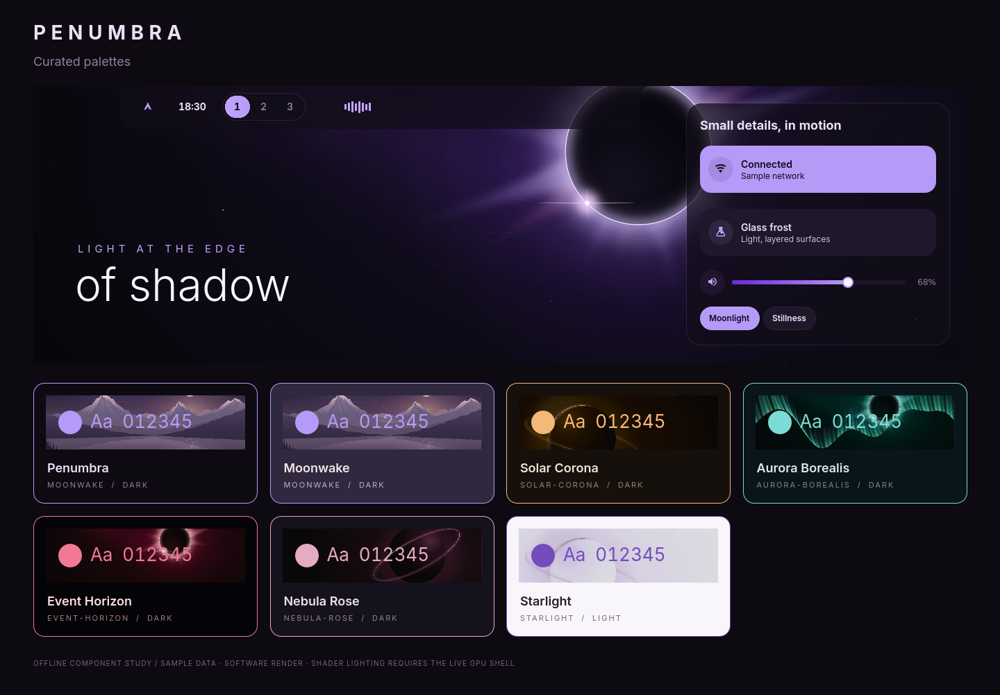
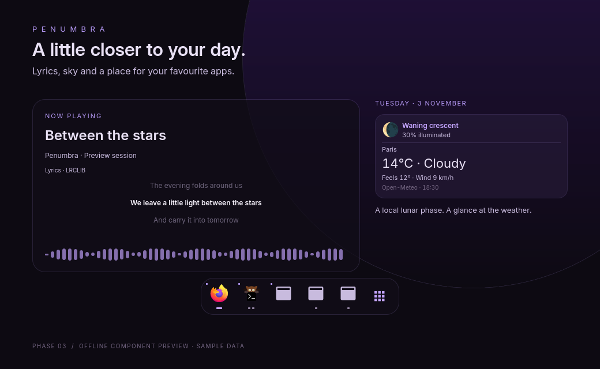
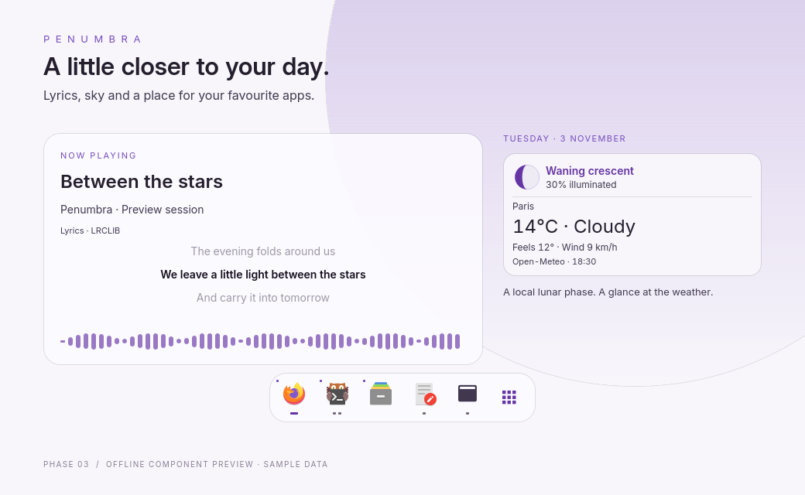

# Maintaining Penumbra

## Common commands

```bash
# Validate MangoWM and restart the shell
mango -p -c "$HOME/.config/mango/config.conf"
~/.local/bin/penumbra-session restart

# Reapply just the user files, without sudo or package installation
./install.sh --user-only

# After changing a colour in palette/palette.toml
python tools/build-palette.py
./install.sh --user-only

# Regenerate the wallpaper PNGs, the SDDM copy and the animated layers after editing an SVG
python tools/build-wallpapers.py
./install.sh

# Recompile the shell's shaders after editing one (needs qt6-shadertools)
python tools/build-shaders.py

# Run the tests (the shell's logic too, with Node.js)
python -m unittest discover -s tests -v

# Inspect logs
journalctl --user -u penumbra-shell -b
quickshell -c penumbra ipc show   # list the shell's IPC commands

# Preview SDDM without logging out; close preview when finished
sddm-greeter-qt6 --test-mode --theme /usr/share/sddm/themes/penumbra
```

## Files and destinations

- `config/` → `~/.config/` (all authored user configuration files, including the shell's systemd unit in `config/systemd/user/`).
- `distro/NAME/` → what differs on one distribution: `distro.sh` (packages and the package manager, the bar's logo glyph, fish's `update`), and `config/`, `bin/`, `share/` and `system/` folders installed over the common ones (the Fastfetch logo, the bar's update checks in `share/penumbra/updates.py`). See [EXTENDING.md](../EXTENDING.md).
- `bin/` → `~/.local/bin/` (session, power and graceful exit, idle, screenshot, screen recording, casting, clipboard, calendar, color picker, OSD, update, GPU reading, wallpaper and shell IPC scripts).
- `config/quickshell/penumbra/` → the Penumbra shell (QML), run by `penumbra-shell.service`.
- `share/` → `~/.local/share/` (KDE color scheme and violet icon overlay).
- `assets/wallpaper*.png` (night, dawn, eclipse and the curated preset scenes, each with a wordmark-free variant) → `~/.local/share/penumbra/`; `lock.png` there links to the clean variant of the current scene. After editing a wallpaper SVG, run `tools/build-wallpapers.py` to re-render them and the SDDM copy; it also splits the dawn and eclipse scenes into the layers under `config/quickshell/penumbra/` that the animated wallpapers move, and compiles the aurora shader (needs `qt6-shadertools`).
- `system/` mirrors absolute system paths: SDDM configuration and complete theme, and the cursor theme.
- `palette/` holds the palette and the templates of the generated colour files (see [Edit the source palette](appearance.md#edit-the-source-palette)).
- `apps/` holds colours for apps Penumbra doesn't install, used only when the app is (see [Application themes](appearance.md#application-themes)).
- `share/kio/servicemenus/penumbra-wallpaper.desktop` and `share/lia-files/actions/penumbra-wallpaper.desktop` → Dolphin and Lia Files right-click **Set as Wallpaper** for images, GIFs and videos.
- `previews/` contains live desktop captures (`desktop.png`, `solar-corona.png`, `starlight.png`, `workspace.png`, `control-center.png`, `launcher.png`, `motion.webp`), offline QML component studies (`widgets.png`, `widgets-light.png`, `aesthetics.png`), and the cursor sheet (`cursors.png`).

`@@PLACEHOLDERS@@` in configuration files (for example, your home folder in the two Qt configurations) are filled in by the installer as it copies them. All other paths are portable home-relative paths or fixed standard system paths. The default shell changes through `usermod`; the installer does not copy account/password databases.

## Shell services and scripting

The bar, notifications, volume/brightness popup, control center, calendar, session overlay, launcher, lock screen, polkit agent and screenshot overlay are one Quickshell configuration in `config/quickshell/penumbra/`, replacing Waybar, Mako, Rofi and the KDE polkit agent. Rofi and swaylock provide fallbacks.

It runs as the systemd user service `penumbra-shell.service`, which `penumbra-session` starts when MangoWM starts. If the shell crashes, systemd starts it again within a second; if the screen was locked, it locks again straight away (MangoWM keeps the session locked in between). Apps started from the shell run in their own systemd scopes, so restarting the shell (Super+Shift+R) never closes them.

**Scripts** reach it through IPC: `quickshell -c penumbra ipc call panel control|wifi|bluetooth|mixer|cast|settings|calendar|monitor|overview|session|updates|wallpapers|downloads|close`, `panel download URL`, `panel page NAME` (a control center page: `wifi`, `bluetooth`, `mixer`, `night`, `cast`, `notifications`, `settings`, `look`, `displays`, `keyboard`, `idle`, `apps`), `launcher apps|windows|clipboard|emoji|symbols`, `lock lock|isLocked`, `nightlight toggle|isOn`, `wallpaper set NAME DELAY`, `shot open false`, `shot record`, `recorder stop|pause|refresh`, `cast stop|refresh`, `osd adjust volume|microphone|brightness up|down|mute|current`, `osd flash volume 40 false`, `osd capsLock`, `notifications clear|dnd`, `updates refresh`. `quickshell -c penumbra ipc show` lists them all with their arguments. `lock lock` prints `false` if the compositor refused the lock. `penumbra-osd`, `penumbra-power`, `penumbra-launcher`, `penumbra-clipboard`, `penumbra-shot` and swayidle fall back to wpctl/brightnessctl, rofi, slurp and swaylock when the shell is not running or the call fails. They go through `penumbra-ipc TARGET FUNCTION [ARGUMENT…]`, which fails when the shell is missing, the target, function or arguments are wrong (`quickshell ipc call` exits 0 for those), or the call returns false. Use it in your own scripts too.

Edit the QML and Quickshell reloads it live (restart the shell with Super+Shift+R after adding a file). `Theme.qml` holds the fonts and type scale, radii and animation timings, and turns the palette into the shell's colour names. Panels, the launcher, notifications and the OSD draw their own soft shadow (`Shadow.qml`) and a lit top edge (`GlassEdge.qml`); the bar's capsules keep a plain outline. The control center and lock screen show your `~/.face` when there is one (`Avatar.qml`).

## Showcase captures

```bash
penumbra-showcase --dry-run
penumbra-showcase --output previews
penumbra-showcase --output previews --monitor DP-1 --video 30
```

Run these in a live MangoWM session with Penumbra installed. The helper opens Fastfetch,
Cava, read-only sample code in Neovim, and terminal swatches on an unused tag,
captures only the selected output, closes its own windows and restores the previous workspaces.
Existing windows are left in place. Each run creates a new directory; it does not overwrite
previous captures. A video run records a 60 fps MP4 and converts a smaller 30 fps looping WebP.
While recording, demonstrate the Control Center, Overview and Launcher using their normal
shortcuts. Cava needs playing audio for a visible spectrum.

The helper requires `mmsg`, `kitty`, `fastfetch`, `cava`, `nvim` and `grim`; video additionally
requires `wf-recorder` and `ffmpeg`. The [desktop gallery](../README.md) was captured in an earlier nested desktop session with a 1920×1080 virtual
output at 125% scale. A second output, rapid panel reversals, reduced motion, and 1024×768 with
130% text were also checked. The motion demonstration includes panels, launcher, dock and a
sample notification. This exercises the actual shaders; it is not a physical multi-monitor
performance benchmark. The image below is a separate offline component study, reproduced by
`python tools/preview-polish.py`, whose software renderer omits shader lighting.



## Widget previews

The screenshots below use actual QML components with offline sample data, rendered without
reading the current desktop, location or media. Reproduce them with:

```bash
python tools/preview-widgets.py
python tools/preview-widgets.py previews/widgets-light.png --light
```




## Technical references

Technical references include the [MangoWM key bindings](https://mangowm.github.io/docs/bindings/keys/), [Kitty configuration](https://sw.kovidgoyal.net/kitty/conf/), [Qt6ct palette implementation](https://github.com/trialuser02/qt6ct/blob/master/src/qt6ct-common/qt6ct.cpp) and [KDE color scheme manager](https://github.com/KDE/kcolorscheme/blob/master/src/kcolorschememanager.cpp).
